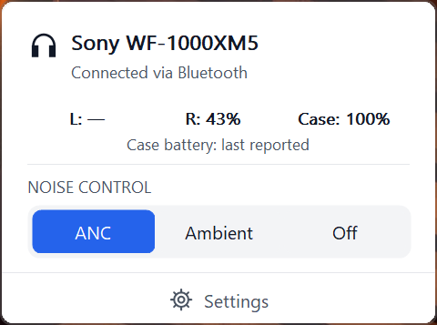
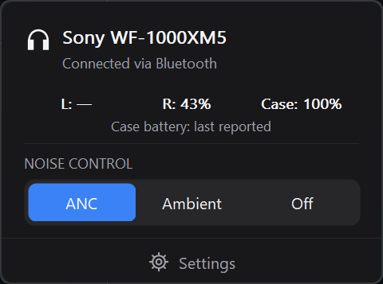

# S-XMTray

A small Windows tray app for **Sony WF-1000XM5**. Change noise control without reaching for your phone.

[Download for Windows x64](https://github.com/maks421400-lgtm/S-XMTray/releases/latest) · [Русский](README.ru.md)

 

English interface in light and dark themes.

## Features

- Noise cancelling, ambient sound and off.
- Earbud and case battery levels.
- Speak-to-Chat and sidetone during calls.
- EQ presets, five bands and Clear Bass.
- Optional global hotkeys, assigned by you.
- Light/dark/system theme, English and Russian, optional Windows startup.

Native C++/Win32. About 400 KB for the app. No installer, account, telemetry or additional runtime.

## Start

1. Connect WF-1000XM5 in Windows Bluetooth settings.
2. Download the release ZIP, extract it into a permanent folder and run **S-XMTray.exe**.
3. Left-click the tray icon for noise control; right-click for settings.

Windows 10/11 x64 and Bluetooth Classic/RFCOMM are required. Tested with WF-1000XM5 firmware **6.1.0**. Other headphone models are not supported. The executable is not digitally signed.

## Settings

**Hotkeys:** choose Ctrl and/or Alt plus a key; Shift is optional. Enable the switch and save. Assignments start empty and disabled. Clear a field to remove one, or disable the switch to keep assignments inactive. Conflicts show an error. F12 and Windows-key shortcuts are not supported.

**Equalizer:** select a preset and click Apply. To edit bands, first apply Custom, Custom 1 or Custom 2. Apply writes to that custom slot. Reset bands prepares a flat draft; Close discards unapplied edits.

**Battery:** a dash means unavailable or disconnected. The case value is the last reported reading and can be cached by the earbuds.

Settings are stored in `%LOCALAPPDATA%\QuietTray\settings.ini`; the original folder name is retained for compatibility. Disable Start with Windows before moving or removing the app. Exit leaves the listening mode unchanged.

## Troubleshooting

If controls are unavailable, reconnect the headphones in Windows and choose Reconnect in the app. If needed, close Sound Connect on your phone. Diagnostics shows the last error. The app retries failed connections every 15 seconds.

Phone automation such as Adaptive Sound Control can change a mode afterwards. Bluetooth drivers and sleep/resume behaviour may vary. [Report a problem](https://github.com/maks421400-lgtm/S-XMTray/issues) with your Windows version, headphone firmware and steps to reproduce it.

## Build and license

Install Visual Studio 2022 C++ Build Tools and the Windows SDK, then run `build.cmd`. It builds the app and runs tests. See [development notes](docs/DEVELOPMENT.md) for packaging and diagnostics.

[MIT](LICENSE). Protocol work references [SonyHeadphonesClient](https://github.com/mos9527/SonyHeadphonesClient); see [third-party notices](THIRD_PARTY_NOTICES.md).

Independent project, not affiliated with Sony. No Sony application files or assets are included.
