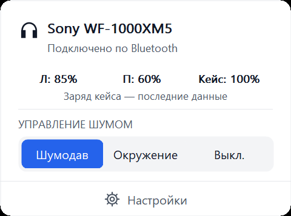
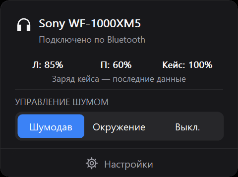

# S-XMTray

Небольшая утилита для **Sony WF-1000XM5** в трее Windows. Переключает шумоподавление без телефона.

[Скачать для Windows x64](https://github.com/maks421400-lgtm/S-XMTray/releases/latest) · [English](README.md)

 

Примеры интерфейса с демонстрационными значениями заряда.

## Возможности

- Шумоподавление, окружающий звук и выключение обоих режимов.
- Заряд наушников и кейса.
- Speak-to-Chat и слышимость своего голоса при звонках.
- Пресеты эквалайзера, пять полос и Clear Bass.
- Горячие клавиши с собственными назначениями и общим выключателем.
- Светлая, тёмная и системная темы, русский и английский, автозапуск по желанию.

Нативное приложение на C++/Win32, около 400 КБ. Без установки, аккаунта, телеметрии и дополнительных сред выполнения.

## Запуск

1. Подключите WF-1000XM5 через Bluetooth в настройках Windows.
2. Скачайте ZIP из Releases, распакуйте в постоянную папку и запустите **S-XMTray.exe**.
3. Левый клик по значку трея открывает управление шумом, правый — настройки.

Нужны Windows 10/11 x64 и Bluetooth Classic/RFCOMM. Проверено на WF-1000XM5 с прошивкой **6.1.0**. Другие модели пока не поддерживаются. Цифровой подписи у сборки нет.

## Настройки

**Хоткеи:** нажмите сочетание Ctrl и/или Alt с клавишей; Shift необязателен. Включите общий переключатель и сохраните. Изначально назначения пустые и выключены. «Очистить» удаляет одно назначение; общий выключатель сохраняет комбинации. Занятые сочетания вызывают ошибку. F12 и комбинации с клавишей Windows не поддерживаются.

**Эквалайзер:** выберите пресет и нажмите «Применить». Для ручной настройки сначала примените Custom, Custom 1 или Custom 2. Следующее применение сохранит полосы в этот пользовательский пресет. «Сбросить полосы» готовит ровную настройку; «Закрыть» отбрасывает неприменённые изменения.

**Заряд:** прочерк означает отсутствие данных или связи. Заряд кейса — последнее значение, переданное наушниками; оно может быть устаревшим.

Настройки хранятся в `%LOCALAPPDATA%\QuietTray\settings.ini`: прежнее имя папки сохранено для совместимости. Перед переносом или удалением программы отключите автозапуск. Выход не меняет режим наушников.

## Если что-то не работает

Переподключите наушники в Windows и нажмите «Переподключить» в приложении. При необходимости закройте Sound Connect на телефоне. Последняя ошибка доступна в диагностике. Повтор подключения выполняется каждые 15 секунд.

Adaptive Sound Control на телефоне может менять режим после вашего выбора. Работа разных Bluetooth-драйверов и восстановление после сна могут отличаться. Сообщая об ошибке в [Issues](https://github.com/maks421400-lgtm/S-XMTray/issues), укажите Windows, прошивку наушников и шаги воспроизведения.

## Сборка и лицензия

Нужны Visual Studio 2022 C++ Build Tools и Windows SDK. Запустите `build.cmd`; сборка также выполняет тесты. Подробности — в [инструкции разработчика](docs/DEVELOPMENT.md).

[MIT](LICENSE). При реализации протокола использовался [SonyHeadphonesClient](https://github.com/mos9527/SonyHeadphonesClient); лицензия сохранена в [THIRD_PARTY_NOTICES.md](THIRD_PARTY_NOTICES.md).

Независимый проект, не связанный с Sony. Файлы и ресурсы приложения Sony не распространяются.
